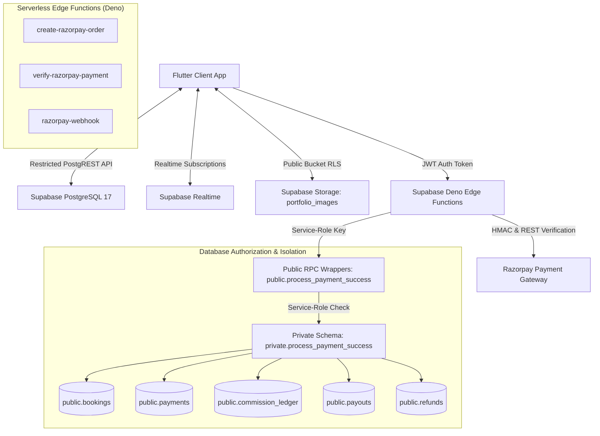

# PYP — Pick Your Photographer

[](https://flutter.dev)
[](https://supabase.com)
[](LICENSE)
[](https://flutter.dev)
[](https://flutter.dev)

An editorial photography marketplace platform connecting clients with professional photographers through server-authoritative booking, payment, notification, and portfolio management workflows.

Built with **Flutter** (Mobile/Web/Desktop) and **Supabase** (PostgreSQL 17, Row Level Security, Realtime, Storage, Deno Edge Functions).

---

## Documentation Quick Links

- [Project Status & Implementation Report](docs/PROJECT_STATUS.md)
- [Payment Flow & Security Architecture](docs/PAYMENT_FLOW_AND_SECURITY.md)

---

## Development Status & Verified Capabilities

PYP utilizes a **Zero-Trust, Server-Authoritative** architecture where all authorization decisions, fee calculations, role checks, and payment verifications are enforced at the database layer.

| System / Subsystem | Implementation Status | Verification Level |
| :--- | :---: | :---: |
| **Role-Based Access Control (RBAC)** | `Implemented` | `Verified (Server RLS)` |
| **Marketplace Discovery & Search** | `Implemented` | `Verified (Flutter + RLS)` |
| **Portfolio Upload & Storage Manager** | `Implemented` | `Verified (Storage RLS)` |
| **Server-Authoritative Booking Logic** | `Implemented` | `Verified (RPC + Paise)` |
| **Razorpay Checkout & Signature Verification** | `Implemented` | `Verified (HMAC-SHA256)` |
| **Service-Role Payment RPC Wrappers** | `Implemented` | `Verified (Local DB + Edge)` |
| **Auditable Refund Ledger & Hardening** | `Implemented` | `Verified (Ledger + RLS)` |
| **Realtime Booking Chat System** | `Implemented` | `Verified (Participant RLS)` |
| **Realtime Notifications System** | `Implemented` | `Verified (Write Hardened)` |
| **Authoritative PDF Invoice Generation** | `Implemented` | `Verified (PDF Export)` |
| **Admin Platform Governance Dashboard** | `Implemented` | `Verified (Admin RPCs)` |

---

## High-Level System Architecture



---

## Marketplace Workflow Journey

```
[Customer Request] ──> [Photographer Accepts] ──> [Order Creation] ──> [Payment Verification / Webhook]
       │                        │                        │                        │
  RPC: create_              RPC: photographer_    Edge Function:           Edge Function:
  booking_request           respond_booking       create-razorpay-order    verify-razorpay-payment
  (Calculates 5%            (Transitions to       (Calls prepare_booking   (Verifies HMAC & amount,
   platform fee)             'accepted')           _for_payment)            invokes process_payment
                                                                            _success wrapper)
```

1. **Quotation & Request**: Customer selects an approved photographer and submits event details. `create_booking_request` RPC calculates the 5% PYP platform fee server-side in integer paise (`total = quote + 5% fee`).
2. **Response**: Photographer accepts or declines the request on their dashboard.
3. **Checkout**: `create-razorpay-order` Edge Function verifies caller authentication and creates a Razorpay payment order for the exact server-calculated paise total.
4. **Verification & Confirmation**: `verify-razorpay-payment` or `razorpay-webhook` verifies the HMAC SHA-256 signature and payment details with Razorpay API, then invokes `public.process_payment_success` using the `service_role` key.
5. **Settlement & Unlocks**: Booking transitions to `confirmed`, platform fee is posted to `commission_ledger`, photographer payout is recorded in `payouts`, and participant chat is unlocked.

---

## Financial Logic & Platform Fee Breakdown

PYP charges customers a transparent **5% platform service fee** on top of the photographer's quoted price:

- **Formula**:
  - `platform_fee_paise = round(photographer_quote_paise * 5 / 100)`
  - `customer_total_paise = photographer_quote_paise + platform_fee_paise`
- **Example**:
  - Photographer Quotation: ₹1,000 (100,000 paise)
  - PYP Platform Fee (5%): ₹50 (5,000 paise)
  - Customer Total Payable: ₹1,050 (105,000 paise)
  - Photographer Payout: ₹1,000 (100,000 paise)
  - PYP Retained Platform Revenue: ₹50 (5,000 paise)
- **Precision**: All financial data is calculated and stored in integer paise across database RPCs and Edge Functions, avoiding floating-point currency discrepancies.

---

## Role-Based Access Control (RBAC) Overview

PYP enforces three distinct server-verified roles in `public.user_roles`:

### 1. Client / Customer (`customer`)
- Browse approved/published photographers.
- Submit booking requests and manage own bookings.
- Pay deposit, view invoices, generate PDF receipts, and chat with photographers for confirmed bookings.

### 2. Photographer (`photographer`)
- Manage public profile and private contact details.
- Upload, replace, and delete portfolio images in `portfolio_images` bucket (protected by folder-ownership RLS).
- Manage incoming booking requests and participate in confirmed booking chats.
- Unapproved or suspended profiles default to `is_published = false` and are hidden from public discovery.

### 3. Administrator (`admin`)
- Access dedicated Admin Platform Governance Dashboard.
- Monitor real-time platform statistics (`admin_get_platform_stats`), bookings, and client directory.
- Moderate photographer applications (`approve`, `reject`, `suspend`, `reactivate`).
- Provisioned exclusively via trusted SQL procedure (`SELECT private.provision_admin('admin@domain.com')`).

---

## Secure Procedure for Provisioning the First Admin

Public signup strictly rejects requests to assign the `admin` role. The initial administrator must be provisioned via SQL:

1. Register a user account in PYP (e.g. `admin@pyp.app`) via the app or Supabase console.
2. Open your local or production Supabase SQL Editor.
3. Execute the provisioning procedure:
   ```sql
   SELECT private.provision_admin('admin@pyp.app');
   ```
4. Upon next sign-in, the user will be assigned the `admin` role in `public.user_roles`.

---

## Environment Variables & Configuration

Create a `.env` file in the project root or configure environment secrets in Supabase Edge Functions:

```env
# Flutter / Client Environment Variables
SUPABASE_URL=http://127.0.0.1:54321
SUPABASE_ANON_KEY=your_publishable_anon_key_here

# Supabase Edge Function Secrets (Set via 'supabase secrets set')
SUPABASE_SERVICE_ROLE_KEY=your_service_role_key_here
RAZORPAY_KEY_ID=your_razorpay_key_id_here
RAZORPAY_KEY_SECRET=your_razorpay_key_secret_here
RAZORPAY_WEBHOOK_SECRET=your_razorpay_webhook_secret_here
```

*Note: Never hardcode `SUPABASE_SERVICE_ROLE_KEY`, `RAZORPAY_KEY_SECRET`, or `RAZORPAY_WEBHOOK_SECRET` in Flutter client code.*

---

## Local Setup & Testing Instructions

### Prerequisites
- [Flutter SDK](https://docs.flutter.dev/get-started/install) (v3.19+)
- [Supabase CLI](https://supabase.com/docs/guides/cli)
- [Docker Desktop](https://www.docker.com/products/docker-desktop/)

### 1. Local Supabase Container Stack
```bash
# Start local Supabase containers
supabase start

# Run all 128 local pgTAP database security tests
supabase test db --local
```

### 2. Flutter Application
```bash
# Install Flutter dependencies
flutter pub get

# Run static code analysis
flutter analyze

# Run Flutter unit and widget tests
flutter test
```

---

## Project Structure Tree

```
pyp_app/
├── lib/
│   ├── main.dart                      # Core app entry, routing & screens
│   ├── theme/
│   │   └── app_theme.dart             # Material 3 editorial design system
│   ├── services/
│   │   ├── portfolio_service.dart     # Storage bucket image manager
│   │   └── invoice_pdf_service.dart   # Authoritative PDF invoice generator
│   └── widgets/
│       ├── booking_card.dart          # Booking card with actions & badges
│       ├── booking_chat_screen.dart   # Realtime confirmed booking chat
│       ├── booking_dialog.dart        # Booking request modal & date picker
│       ├── empty_state_widget.dart    # Reusable loading, error & empty states
│       ├── image_preview_dialog.dart  # Interactive photo preview dialog
│       ├── invoice_dialog.dart        # Invoice viewer & PDF export sheet
│       ├── notifications_widget.dart  # Realtime notification center
│       ├── photographer_card.dart     # Marketplace photographer card
│       ├── portfolio_manager_widget.dart # Photographer portfolio uploader
│       ├── portfolio_viewer_widget.dart # Customer portfolio showcase
│       └── pyp_header.dart            # Responsive header & role switcher
├── test/                              # 42 Flutter unit & widget tests
├── supabase/
│   ├── functions/                     # Deno Edge Functions
│   │   ├── create-razorpay-order/
│   │   ├── verify-razorpay-payment/
│   │   └── razorpay-webhook/
│   ├── migrations/                    # 17 forward-only SQL migrations
│   └── tests/database/                # 13 pgTAP database security test suites
├── pubspec.yaml
└── README.md
```

---

## License & Contribution

This project is maintained for the **PYP — Pick Your Photographer** marketplace. Contributions and security improvements should follow forward-only database migration standards and include accompanying pgTAP security tests.
