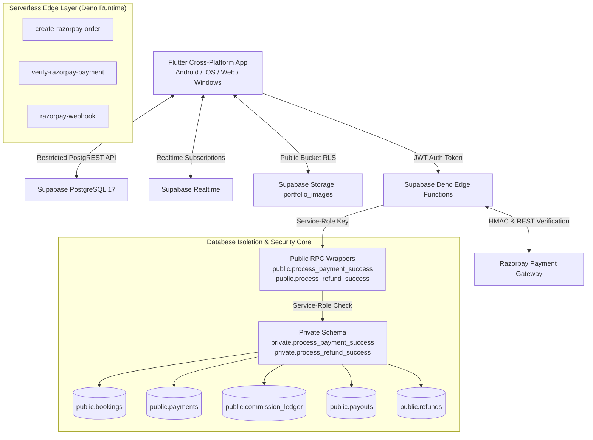
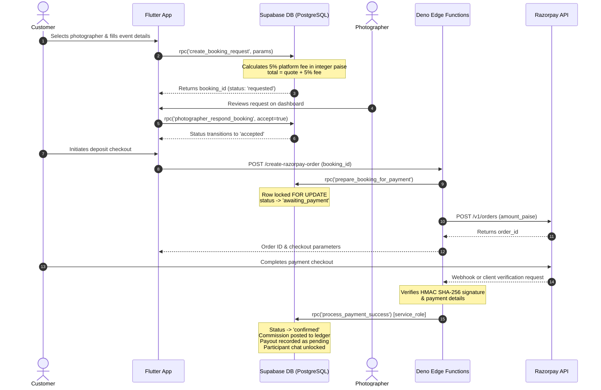

# PYP — Pick Your Photographer

<div align="center">

  <h3>Pick Your Photographer — Premium Editorial Marketplace</h3>
  <p>An editorial photography marketplace connecting clients with vetted professional photographers through server-authoritative booking, payment, notification, and portfolio management workflows.</p>

  [](https://flutter.dev)
  [](https://supabase.com)
  [](https://dart.dev)
  [](LICENSE)

  [](https://flutter.dev)
  [](https://flutter.dev)
  [](https://supabase.com)
  [](supabase/migrations)

</div>

---

## 📚 Technical Documentation Index

| Document | Primary Focus & Contents |
| :--- | :--- |
| 📊 **[Project Status](docs/PROJECT_STATUS.md)** | Executive summary, tech stack manifest, milestone checklist, test evidence & deployment status. |
| 🏗️ **[System Architecture](docs/ARCHITECTURE.md)** | High-level component design, Flutter layers, Supabase backend, Edge Functions, trust boundaries. |
| 🔄 **[Booking Lifecycle](docs/BOOKING_LIFECYCLE.md)** | Booking state machine, transition matrix, financial fee formulas, chat unlocking & refund settlement. |
| 🛡️ **[Security Model](docs/SECURITY_MODEL.md)** | RBAC enforcement, PostgreSQL RLS policies, storage folder RLS, service-role RPC wrappers, threat matrix. |
| 🗄️ **[Database Schema](docs/DATABASE_SCHEMA.md)** | Mermaid ER diagram, table references, custom ENUM types, key indexes, 17 chronological migrations. |
| 🧪 **[Testing Strategy](docs/TESTING.md)** | Flutter analyze, 42 widget tests, 128 pgTAP DB checks, PowerShell runner, integration test setup. |
| 🚀 **[Deployment Guide](docs/DEPLOYMENT.md)** | Supabase migration push, Edge Function deployment, secret configuration, release builds & rollback steps. |
| 💳 **[Payment & Security Flow](docs/PAYMENT_FLOW_AND_SECURITY.md)** | End-to-end Razorpay integration, HMAC verification, webhook deduplication, refund ledger processing. |
| 🗺️ **[Product Roadmap](ROADMAP.md)** | Completed features, in-progress onboarding, and planned post-launch enhancements. |

---

## ⚡ Verified Status Dashboard

| Verification Layer | Local Test Command | Execution Result | Verification Scope |
| :--- | :--- | :---: | :--- |
| **Flutter Static Analysis** | `flutter analyze` | **PASSED (0 issues)** | Zero lint, type, or static analysis warnings across `lib/` and `test/`. |
| **Flutter Test Suite** | `flutter test test` | **PASSED (42 / 42)** | Auth routing, marketplace search, fee calculations, PDF invoice export & chat. |
| **Database Security (pgTAP)** | `supabase test db --local` | **PASSED (128 / 128)** | RLS policies, RBAC, RPC authorization, refund ceiling, notification write security. |
| **Automated Test Runner** | `.\tool\run_pyp_tests.ps1` | **PASSED (2 / 2 tasks)** | Combined analyzer and widget test execution script. |
| **Local Migrations** | `supabase migration list` | **17 Applied** | 17 forward-only SQL migrations applied to local container database. |

---

## 🏛️ System Architecture

PYP utilizes a **Zero-Trust, Server-Authoritative Architecture**. Authorization decisions, 5% fee calculations, role checks, and contact detail releases are enforced at the database layer.



---

## 🔄 Booking & Settlement Journey



---

## 💡 Role-Based Feature Matrix

| Capability / Feature | Customer (`customer`) | Photographer (`photographer`) | Administrator (`admin`) |
| :--- | :---: | :---: | :---: |
| **Marketplace Search & Category Filter** | ✅ | ✅ | ✅ |
| **View Published Portfolios** | ✅ | ✅ | ✅ |
| **Submit Booking Requests** | ✅ | ❌ | ❌ |
| **Accept / Decline Booking Requests** | ❌ | ✅ | ❌ |
| **Upload / Manage Portfolio Images** | ❌ | ✅ | ❌ |
| **Pay Booking Deposit via Razorpay** | ✅ | ❌ | ❌ |
| **Realtime Chat (Confirmed Bookings)** | ✅ | ✅ | ❌ |
| **Generate & Export PDF Invoices** | ✅ | ✅ | ✅ |
| **View Private Contact Details** | ✅ (Confirmed Only) | ✅ (Confirmed Only) | ✅ |
| **Approve / Suspend Photographers** | ❌ | ❌ | ✅ |
| **View Platform Revenue & Stats** | ❌ | ❌ | ✅ |

---

## 💰 Financial Logic & Platform Fee Breakdown

PYP charges customers a transparent **5% platform service fee** on top of the photographer's quoted price:

- **Formula**:
  $$\text{platform\_fee\_paise} = \text{round}\left(\frac{\text{photographer\_quote\_paise} \times 5.0}{100.0}\right)$$
  $$\text{customer\_total\_paise} = \text{photographer\_quote\_paise} + \text{platform\_fee\_paise}$$
- **Example Breakdown**:
  - Photographer Quotation: **₹1,000** (100,000 paise)
  - PYP Platform Fee (5%): **₹50** (5,000 paise)
  - Customer Total Payable: **₹1,050** (105,000 paise)
  - Photographer Payout: **₹1,000** (100,000 paise)
  - PYP Retained Platform Revenue: **₹50** (5,000 paise)
- **Monetary Precision**: All monetary values are handled strictly in integer paise across database RPCs, Edge Functions, and Flutter UI, avoiding floating-point currency rounding errors.

---

## 🛡️ Security Architecture Summary

- **Server-Side Authorization**: Roles are stored in `public.user_roles` and checked using recursion-safe functions (`private.is_admin()`).
- **Metadata Tampering Immunity**: Public signups passing `requested_role: 'admin'` in user metadata are strictly overridden to `customer` by the `private.handle_new_user()` trigger.
- **Row Level Security (RLS)**: Active on 100% of tables. Direct client write privileges on `payments`, `payouts`, `commission_ledger`, `refunds`, and `notifications` are revoked.
- **Service Role RPC Wrappers**: `public.process_payment_success` and `public.process_refund_success` specify `SECURITY DEFINER`, `SET search_path = ''`, and enforce `auth.role() = 'service_role'`.
- **Storage Ownership RLS**: Files in `portfolio_images` bucket are strictly bound to `<user_id>/...` folders using `(storage.foldername(name))[1] = auth.uid()`.

---

## 🗄️ Database & Edge Functions Overview

- **Database Engine**: PostgreSQL 17 with 17 forward-only SQL migrations (`20261011134024` through `20261016120000`).
- **Edge Functions**:
  - `create-razorpay-order`: Generates Razorpay checkout orders.
  - `verify-razorpay-payment`: Validates payment signatures and confirms bookings.
  - `razorpay-webhook`: Asynchronous webhook handler for captured payments, failures, and refunds with event deduplication (`processed_webhook_events`).

---

## 📂 Repository Directory Tree

```
pyp_app/
├── docs/                               # Comprehensive Technical Documentation
│   ├── ARCHITECTURE.md                 # System architecture & component design
│   ├── BOOKING_LIFECYCLE.md            # Booking state machine & financial formulas
│   ├── DATABASE_SCHEMA.md              # Database ER diagram & 17 migrations
│   ├── DEPLOYMENT.md                   # Migration, Edge Function & build setup
│   ├── PAYMENT_FLOW_AND_SECURITY.md    # Razorpay, HMAC & RPC wrapper security
│   ├── PROJECT_STATUS.md               # Executive status report & test evidence
│   ├── SECURITY_MODEL.md               # RLS policies & threat mitigation
│   └── TESTING.md                      # Flutter & pgTAP testing guide
├── lib/
│   ├── main.dart                       # Core app entry, routing & screens
│   ├── firebase_options.dart           # FlutterFire configuration options
│   ├── theme/
│   │   └── app_theme.dart              # Material 3 dark editorial design system
│   ├── services/
│   │   ├── portfolio_service.dart      # Storage bucket image manager
│   │   └── invoice_pdf_service.dart    # Authoritative PDF invoice generator
│   └── widgets/
│       ├── booking_card.dart           # Booking card with actions & status badges
│       ├── booking_chat_screen.dart    # Realtime confirmed booking chat
│       ├── booking_dialog.dart         # Booking request modal & date picker
│       ├── empty_state_widget.dart     # Reusable loading, error & empty states
│       ├── image_preview_dialog.dart   # Interactive photo preview dialog
│       ├── invoice_dialog.dart         # Invoice viewer & PDF export sheet
│       ├── notifications_widget.dart   # Realtime notification center
│       ├── photographer_card.dart      # Marketplace photographer card
│       ├── portfolio_manager_widget.dart  # Photographer portfolio uploader
│       ├── portfolio_viewer_widget.dart  # Customer portfolio showcase
│       └── pyp_header.dart             # Responsive header & role switcher
├── test/                               # 42 Flutter unit & widget tests
├── integration_test/                   # Mobile & web integration tests
├── supabase/
│   ├── functions/                      # Deno Edge Functions
│   │   ├── create-razorpay-order/
│   │   ├── verify-razorpay-payment/
│   │   └── razorpay-webhook/
│   ├── migrations/                     # 17 forward-only SQL migrations
│   └── tests/database/                 # 13 pgTAP database security test suites
├── tool/
│   └── run_pyp_tests.ps1               # Automated PowerShell test runner
├── ROADMAP.md                          # Product roadmap & feature milestones
├── pubspec.yaml
└── README.md
```

---

## 🛠️ Local Setup & Development Instructions

### Prerequisites
- [Flutter SDK](https://docs.flutter.dev/get-started/install) (`^3.19.0` or higher)
- [Supabase CLI](https://supabase.com/docs/guides/cli) (`v2.117.0` or higher)
- [Docker Desktop](https://www.docker.com/products/docker-desktop/)

### 1. Environment Configuration
Create a `.env` file in the project root or configure environment secrets in Supabase Edge Functions:

```env
# Flutter Client Variables
SUPABASE_URL=http://127.0.0.1:54321
SUPABASE_ANON_KEY=your_publishable_anon_key_here

# Supabase Edge Function Secrets (Set via 'supabase secrets set')
SUPABASE_SERVICE_ROLE_KEY=your_service_role_key_here
RAZORPAY_KEY_ID=your_razorpay_key_id_here
RAZORPAY_KEY_SECRET=your_razorpay_key_secret_here
RAZORPAY_WEBHOOK_SECRET=your_razorpay_webhook_secret_here
```

### 2. Running Local Supabase Stack
```bash
# Start local Supabase containers
supabase start

# Run all 128 local pgTAP database security tests
supabase test db --local
```

### 3. Running Flutter Application
```bash
# Install Flutter dependencies
flutter pub get

# Run static code analysis
flutter analyze

# Run unit and widget tests
flutter test test
```

---

## 📄 License & Contribution

This project is maintained for the **PYP — Pick Your Photographer** marketplace. Contributions and security improvements should follow forward-only database migration standards and include accompanying pgTAP security tests.
