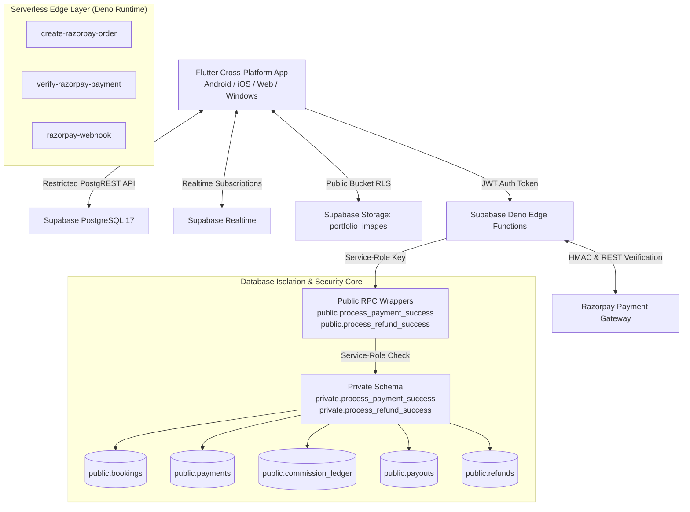
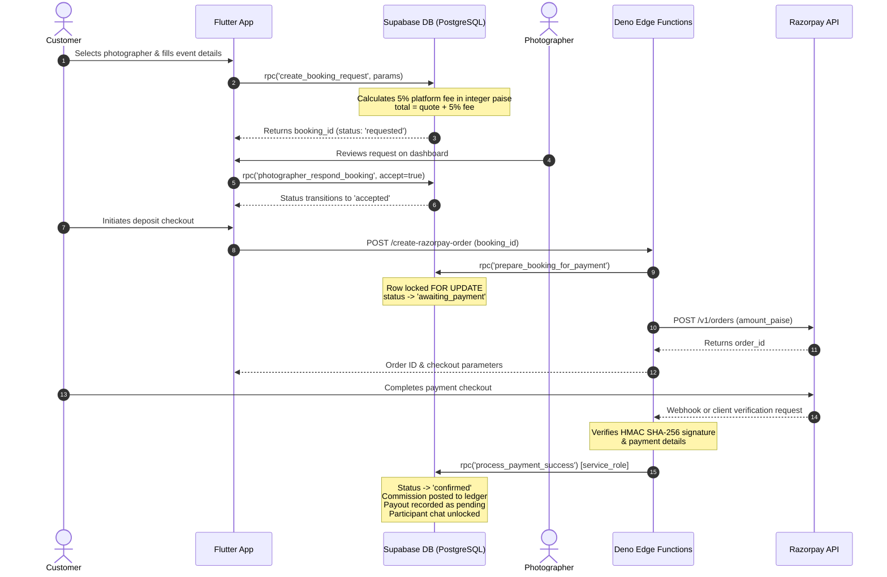
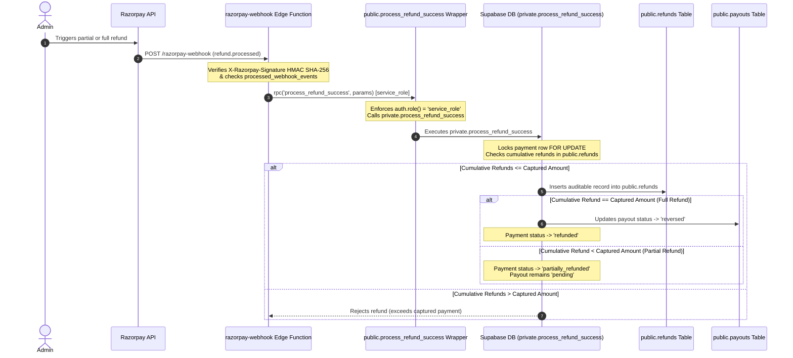
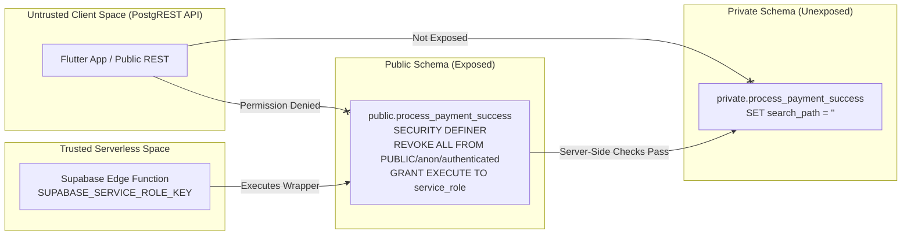

# PYP — Pick Your Photographer

<div align="center">

  <h1>PYP — Pick Your Photographer</h1>
  <p><b>An Editorial Cross-Platform Marketplace Built with Flutter, Supabase & Razorpay</b></p>
  <p>A server-authoritative photography marketplace connecting clients with vetted professional photographers through secure booking, payment, notification, chat, and portfolio management workflows.</p>

  [](https://github.com/Aravindan-001/PYP-NEXORA-CLIENT/actions/workflows/ci.yml)
  [](https://flutter.dev)
  [](https://supabase.com)
  [](https://dart.dev)
  [](LICENSE)

  [](https://flutter.dev)
  [](https://flutter.dev)
  [](https://supabase.com)
  [](supabase/migrations)

</div>

---

## 📚 Technical Documentation Index

To maintain a concise, scannable README, detailed architectural, security, testing, and deployment specifications live in dedicated engineering documents:

| Document | Scope & Contents |
| :--- | :--- |
| 📊 **[Project Status Report](docs/PROJECT_STATUS.md)** | Executive summary, tech stack manifest, milestone checklist, test evidence & deployment readiness. |
| 🏗️ **[System Architecture](docs/ARCHITECTURE.md)** | High-level component design, Flutter layers, Supabase backend, Edge Functions, trust boundaries. |
| 🔄 **[Booking Lifecycle](docs/BOOKING_LIFECYCLE.md)** | Booking state machine, transition matrix, financial fee formulas, chat unlocking & refund settlement. |
| 🛡️ **[Security Model](docs/SECURITY_MODEL.md)** | RBAC enforcement, PostgreSQL RLS policies, storage folder RLS, service-role RPC wrappers, threat matrix. |
| 🗄️ **[Database Schema](docs/DATABASE_SCHEMA.md)** | Mermaid ER diagram, table references, custom ENUM types, key indexes, 17 chronological migrations. |
| 🧪 **[Testing Strategy](docs/TESTING.md)** | Flutter analyze, 42 widget tests, 128 pgTAP DB checks, PowerShell runner, integration test setup. |
| 🚀 **[Deployment Guide](docs/DEPLOYMENT.md)** | Supabase migration push, Edge Function deployment, secret configuration, release builds & rollback steps. |
| 💳 **[Payment & Security Flow](docs/PAYMENT_FLOW_AND_SECURITY.md)** | End-to-end Razorpay integration, HMAC verification, webhook deduplication, refund ledger processing. |
| 🗺️ **[Product Roadmap](ROADMAP.md)** | Completed features, in-progress onboarding, and planned post-launch enhancements. |

---

## ⚡ Verified Status Dashboard

| Quality Signal | Local Test Command | Result | Verification Scope |
| :--- | :--- | :---: | :--- |
| **Flutter Static Analysis** | `flutter analyze` | **PASSED (0 issues)** | Zero lint, type, or static analysis warnings across `lib/` and `test/`. |
| **Flutter Unit & Widget Tests** | `flutter test test` | **PASSED (42 / 42)** | Auth routing, marketplace search, fee calculations, PDF invoice export & chat. |
| **Database Security (pgTAP)** | `supabase test db --local` | **PASSED (128 / 128)** | RLS policies, RBAC, RPC authorization, refund ceiling, notification write security. |
| **GitHub Actions CI** | `.github/workflows/ci.yml` | **Configured** | Automated Flutter analyze/test/build + Supabase DB pgTAP test workflow. |
| **Automated Test Runner** | `.\tool\run_pyp_tests.ps1` | **PASSED (2 / 2 tasks)** | Combined analyzer and widget test execution script. |
| **Local Migrations** | `supabase migration list` | **17 Applied** | 17 forward-only SQL migrations applied to local container database. |

---

## 🏛️ System Architecture & Trust Boundaries

PYP utilizes a **Zero-Trust, Server-Authoritative Architecture**. Authorization decisions, 5% fee calculations, role checks, and payment verifications are enforced at the database layer.



---

## 🔄 Booking & Payment Lifecycle



---

## 💸 Refund Accounting & Reversal Lifecycle



---

## 🔒 RPC Security Wrapper Isolation



---

## 📊 Feature Maturity & Verification Matrix

| Capability / Subsystem | Implementation Status | Automated Test Level | Verification Level |
| :--- | :---: | :---: | :---: |
| **Authentication & Session Routing** | `Implemented` | `42 Unit & Widget Tests` | `Verified Locally` |
| **Server-Enforced Role-Based Access (RBAC)** | `Implemented` | `12 pgTAP DB Tests` | `Verified (Server RLS)` |
| **Marketplace Search & Category Filter** | `Implemented` | `Widget & Unit Tests` | `Verified Locally` |
| **Portfolio Upload & Storage Manager** | `Implemented` | `11 pgTAP DB Tests` | `Verified (Storage RLS)` |
| **Unapproved Photographer Isolation** | `Implemented` | `pgTAP DB Tests` | `Verified (Server RLS)` |
| **Server-Authoritative Fee Calculation** | `Implemented` | `Unit & DB Tests` | `Verified (Integer Paise)` |
| **Razorpay Checkout & Signature Check** | `Implemented` | `6 pgTAP DB Tests` | `Verified (HMAC-SHA256)` |
| **Service-Role Payment RPC Wrappers** | `Implemented` | `12 pgTAP DB Tests` | `Verified (Local DB + Edge)` |
| **Auditable Refund Ledger & Ceiling** | `Implemented` | `13 pgTAP DB Tests` | `Verified (Ledger + RLS)` |
| **Realtime Confirmed Session Chat** | `Implemented` | `Widget & RLS Tests` | `Verified (Participant RLS)` |
| **Realtime Notifications System** | `Implemented` | `19 pgTAP DB Tests` | `Verified (Write Hardened)` |
| **Authoritative PDF Invoice Export** | `Implemented` | `Unit & Widget Tests` | `Verified (PDF Export)` |
| **Admin Governance Dashboard** | `Implemented` | `6 pgTAP DB Tests` | `Verified (Admin RPCs)` |
| **Automated Razorpay Route Transfers** | `Planned` | `Database Ready` | `Pending Merchant Setup` |
| **Production Remote Deployment** | `Planned` | `Local Suite Passing` | `Pending User Approval` |

---

## 📸 Product Showcase & Screenshot Capture Guide

PYP features a Material 3 editorial dark design system with an Obsidian Black (`#080808`) and Champagne Gold (`#C6A76A`) palette:

- **Auth Screen**: Branded sign-in/sign-up card with logo and password visibility toggle.
- **Discover Marketplace**: Hero banner, search bar, category chips, and photographer cards.
- **Photographer Profile**: Profile details, private contact info, and portfolio manager.
- **Booking Reservation Dialog**: Date picker, event details, and transparent 5% fee summary.
- **My Bookings Screen**: Booking cards with status badges and action triggers.
- **Authoritative Invoice PDF**: Printable/exportable PDF tax invoices and receipts.
- **Realtime Session Chat**: Participant-only chat unlocked strictly for confirmed bookings.
- **Admin Dashboard**: Realtime stats, photographer moderation, and client directory.

*To capture and add emulator screenshots or a demo GIF, refer to [docs/screenshots/README.md](docs/screenshots/README.md).*

---

## 💰 Financial Logic & Platform Fee Breakdown

PYP charges customers a transparent **5% platform service fee** on top of the photographer's quoted price:

- **Formula**:
  $$\text{platform\_fee\_paise} = \text{round}\left(\frac{\text{photographer\_quote\_paise} \times 5.0}{100.0}\right)$$
  $$\text{customer\_total\_paise} = \text{photographer\_quote\_paise} + \text{platform\_fee\_paise}$$
- **Example**:
  - Photographer Quotation: **₹1,000** (100,000 paise)
  - PYP Platform Fee (5%): **₹50** (5,000 paise)
  - Customer Total Payable: **₹1,050** (105,000 paise)
  - Photographer Payout: **₹1,000** (100,000 paise)
  - PYP Retained Platform Revenue: **₹50** (5,000 paise)
- **Monetary Precision**: All financial data is calculated and stored in integer paise across database RPCs and Edge Functions, avoiding floating-point currency discrepancies.

---

## 🔑 Role-Based Access Control (RBAC) Overview

PYP enforces three distinct server-verified roles in `public.user_roles`:

### 1. Client / Customer (`customer`)
- Browse approved/published photographers.
- Submit booking requests and manage own bookings.
- Pay deposit, view invoices, generate PDF receipts, and chat with photographers for confirmed bookings.

### 2. Photographer (`photographer`)
- Manage public profile and private contact details.
- Upload, replace, and delete portfolio images in `portfolio_images` bucket (protected by folder-ownership RLS).
- Manage incoming booking requests and participate in confirmed booking chats.
- Unapproved or suspended profiles default to `is_published = false` and are hidden from public discovery.

### 3. Administrator (`admin`)
- Access dedicated Admin Platform Governance Dashboard.
- Monitor real-time platform statistics (`admin_get_platform_stats`), bookings, and client directory.
- Moderate photographer applications (`approve`, `reject`, `suspend`, `reactivate`).
- Provisioned exclusively via trusted SQL procedure (`SELECT private.provision_admin('admin@domain.com')`).

---

## 🔐 Secure Procedure for Provisioning the First Admin

Public signup strictly rejects requests to assign the `admin` role. The initial administrator must be provisioned via SQL:

1. Register a user account in PYP (e.g. `admin@pyp.app`) via the app or Supabase console.
2. Open your local or production Supabase SQL Editor.
3. Execute the provisioning procedure:
   ```sql
   SELECT private.provision_admin('admin@pyp.app');
   ```
4. Upon next sign-in, the user will be assigned the `admin` role in `public.user_roles`.

---

## ⚙️ Environment Variables & Configuration

Create a `.env` file in the project root or configure environment secrets in Supabase Edge Functions:

```env
# Flutter Client Variables
SUPABASE_URL=http://127.0.0.1:54321
SUPABASE_ANON_KEY=your_publishable_anon_key_here

# Supabase Edge Function Secrets (Set via 'supabase secrets set')
SUPABASE_SERVICE_ROLE_KEY=your_service_role_key_here
RAZORPAY_KEY_ID=your_razorpay_key_id_here
RAZORPAY_KEY_SECRET=your_razorpay_key_secret_here
RAZORPAY_WEBHOOK_SECRET=your_razorpay_webhook_secret_here
```

*Note: Never hardcode `SUPABASE_SERVICE_ROLE_KEY`, `RAZORPAY_KEY_SECRET`, or `RAZORPAY_WEBHOOK_SECRET` in Flutter client code.*

---

## 🛠️ Local Setup & Development Instructions

### Prerequisites
- [Flutter SDK](https://docs.flutter.dev/get-started/install) (`^3.19.0` or higher)
- [Supabase CLI](https://supabase.com/docs/guides/cli) (`v2.117.0` or higher)
- [Docker Desktop](https://www.docker.com/products/docker-desktop/)

### 1. Local Supabase Container Stack
```bash
# Start local Supabase containers
supabase start

# Run all 128 local pgTAP database security tests
supabase test db --local
```

### 2. Flutter Application
```bash
# Install Flutter dependencies
flutter pub get

# Run static code analysis
flutter analyze

# Run Flutter unit and widget tests
flutter test test
```

---

## 📂 Repository Directory Tree

```
pyp_app/
├── .github/
│   └── workflows/
│       └── ci.yml                      # GitHub Actions CI pipeline
├── docs/                               # Comprehensive Technical Documentation
│   ├── screenshots/                    # Screenshot showcase guide
│   ├── ARCHITECTURE.md                 # System architecture & component design
│   ├── BOOKING_LIFECYCLE.md            # Booking state machine & financial formulas
│   ├── DATABASE_SCHEMA.md              # Database ER diagram & 17 migrations
│   ├── DEPLOYMENT.md                   # Migration, Edge Function & build setup
│   ├── PAYMENT_FLOW_AND_SECURITY.md    # Razorpay, HMAC & RPC wrapper security
│   ├── PROJECT_STATUS.md               # Executive status report & test evidence
│   ├── SECURITY_MODEL.md               # RLS policies & threat mitigation
│   └── TESTING.md                      # Flutter & pgTAP testing guide
├── lib/
│   ├── main.dart                       # Core app entry, routing & screens
│   ├── firebase_options.dart           # FlutterFire configuration options
│   ├── theme/
│   │   └── app_theme.dart              # Material 3 editorial design system
│   ├── services/
│   │   ├── portfolio_service.dart      # Storage bucket image manager
│   │   └── invoice_pdf_service.dart    # Authoritative PDF invoice generator
│   └── widgets/
│       ├── booking_card.dart           # Booking card with actions & status badges
│       ├── booking_chat_screen.dart    # Realtime confirmed booking chat
│       ├── booking_dialog.dart         # Booking request modal & date picker
│       ├── empty_state_widget.dart     # Reusable loading, error & empty states
│       ├── image_preview_dialog.dart   # Interactive photo preview dialog
│       ├── invoice_dialog.dart         # Invoice viewer & PDF export sheet
│       ├── notifications_widget.dart   # Realtime notification center
│       ├── photographer_card.dart      # Marketplace photographer card
│       ├── portfolio_manager_widget.dart # Photographer portfolio uploader
│       ├── portfolio_viewer_widget.dart # Customer portfolio showcase
│       └── pyp_header.dart             # Responsive header & role switcher
├── test/                               # 42 Flutter unit & widget tests
├── integration_test/                   # Mobile & web integration tests
├── supabase/
│   ├── functions/                      # Deno Edge Functions
│   │   ├── create-razorpay-order/
│   │   ├── verify-razorpay-payment/
│   │   └── razorpay-webhook/
│   ├── migrations/                     # 17 forward-only SQL migrations
│   └── tests/database/                 # 13 pgTAP database security test suites
├── tool/
│   └── run_pyp_tests.ps1               # Automated PowerShell test runner
├── ROADMAP.md                          # Product roadmap & feature milestones
├── pubspec.yaml
└── README.md
```

---

## 📄 License & Contribution

This project is maintained for the **PYP — Pick Your Photographer** marketplace. Contributions and security improvements should follow forward-only database migration standards and include accompanying pgTAP security tests.
