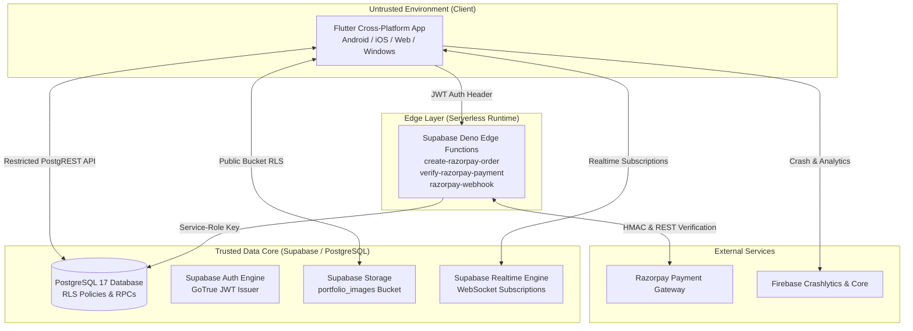

# PYP — System Architecture & Component Design

**Project:** PYP (Pick Your Photographer)  
**Version:** 1.0.0+1  
**Architecture Pattern:** Zero-Trust, Server-Authoritative Marketplace Architecture  

---

## 1. System Overview

**PYP (Pick Your Photographer)** is an editorial photography marketplace designed to connect clients with vetted professional photographers. The system enforces strict component isolation and trust boundaries:



---

## 2. Layered Architecture & Component Responsibilities

### 2.1 Frontend Application Layer (`lib/`)
The Flutter client acts as an interactive presentation and session management layer. It is treated as an **untrusted client**: no financial calculations, role assignments, or security checks are trusted from client code alone.

- **Theme & Design System (`lib/theme/app_theme.dart`)**:
  - Custom Material 3 dark editorial design system.
  - Palette: Obsidian Black (`#080808`), Warm Ivory (`#F1F0EB`), Muted Silver (`#B8B4AA`), Champagne Gold (`#C6A76A`).
- **Services (`lib/services/`)**:
  - `PortfolioService`: Manages image file validation (JPEG/PNG/WebP, <=10MB), path generation (`userId/timestamp_filename`), and upload/deletion calls to Supabase Storage.
  - `InvoicePdfService`: Generates authoritative A4/Mobile PDF tax invoices and receipts using `pdf` (v3.13.1) and `printing` (v5.15.1) packages.
- **Widgets & UI Components (`lib/widgets/`)**:
  - `PypHeader`: Responsive header featuring user profile details, active role badges, and an interactive Role Switcher for multi-role accounts.
  - `PhotographerCard`: Marketplace photographer card with portfolio preview, city, category, starting price in INR (`₹`), and booking CTA.
  - `BookingDialog`: Interactive booking request modal with date picker, client contact fields, and server-calculated fee breakdown.
  - `BookingCard`: Booking list card showing event metadata, status badges, payment triggers, invoice viewer, and chat launcher.
  - `InvoiceDialog`: Authoritative invoice viewer, print, and PDF export dialog.
  - `BookingChatScreen`: Realtime chat widget unlocked strictly for confirmed/completed bookings.
  - `NotificationsWidget`: Realtime notification center with unread badge counter.
  - `PortfolioManagerWidget` & `PortfolioViewerWidget`: Portfolio management and customer showcase widgets.

### 2.2 Backend Services & Data Layer (Supabase Stack)
- **PostgreSQL 17 Database Engine**:
  - Holds 9 public application tables (`profiles`, `user_roles`, `photographer_profiles`, `photographer_private_details`, `bookings`, `payments`, `commission_ledger`, `payouts`, `refunds`, `notifications`, `chat_messages`).
  - Holds 2 internal ledger tables (`processed_webhook_events`, `private` schema functions).
- **PostgREST API**:
  - Automatically exposes the `public` schema over HTTP REST.
  - Protected 100% by Row Level Security (RLS) policies.
- **Supabase Auth (GoTrue)**:
  - Issues JWTs containing user identity (`sub`) and role (`authenticated` / `anon`).
- **Supabase Storage**:
  - Public bucket `portfolio_images` with folder-ownership RLS (`(storage.foldername(name))[1] = auth.uid()`).
- **Supabase Realtime**:
  - WebSocket engine broadcasting database changes to subscribed clients for chat messages and notifications.

### 2.3 Serverless Edge Functions Layer (`supabase/functions/`)
Deno-based serverless functions executing with elevated database privileges via the `SUPABASE_SERVICE_ROLE_KEY`:

1. **`create-razorpay-order`**:
   - Verifies caller JWT.
   - Invokes `prepare_booking_for_payment` RPC to lock the booking row (`FOR UPDATE`) and retrieve server-calculated paise amounts.
   - Reuses existing pending Razorpay order IDs or creates a new Razorpay order via Razorpay REST API (`POST /v1/orders`).
   - Inserts pending payment record into `public.payments`.
2. **`verify-razorpay-payment`**:
   - Verifies caller JWT and booking customer ownership.
   - Verifies Razorpay HMAC SHA-256 payment signature (`razorpay_order_id|razorpay_payment_id`).
   - Fetches payment details from Razorpay REST API and verifies amount (`total_amount_paise`), currency (`INR`), and status (`captured`).
   - Invokes `public.process_payment_success` wrapper using `service_role`.
3. **`razorpay-webhook`**:
   - Asynchronous webhook endpoint receiving Razorpay events (`payment.captured`, `payment.failed`, `refund.processed`).
   - Verifies `X-Razorpay-Signature` HMAC SHA-256 using `RAZORPAY_WEBHOOK_SECRET`.
   - Checks `processed_webhook_events` for event ID deduplication.
   - Invokes `public.process_payment_success` or `public.process_refund_success` wrapper using `service_role`.

---

## 3. Trust Boundaries & Security Architecture

```
┌─────────────────────────────────────────────────────────────────────────┐
│                      UNTRUSTED CLIENT ENVIRONMENT                       │
│  Flutter App (User Input, UI Routing, Local State, Local Rendering)     │
└─────────────────────────────────────────────────────────────────────────┘
                                   │
                                   │ HTTPS / WSS (TLS 1.3)
                                   ▼
┌─────────────────────────────────────────────────────────────────────────┐
│                        TRUST BOUNDARY ENFORCEMENT                        │
│                                                                         │
│  1. PostgreSQL Row Level Security (RLS) on 100% of Application Tables   │
│  2. Service-Role Verification on Public RPC Wrappers                    │
│  3. HMAC SHA-256 Signature Verification on Edge Functions               │
│  4. SECURITY DEFINER RPCs with empty search_path = ''                   │
└─────────────────────────────────────────────────────────────────────────┘
                                   │
                                   ▼
┌─────────────────────────────────────────────────────────────────────────┐
│                        TRUSTED SERVER CORE                              │
│  PostgreSQL Database / Private Schema / Deno Edge Functions / Razorpay   │
└─────────────────────────────────────────────────────────────────────────┘
```

### Trust Rules:
1. **Client Inputs**: Every price, status, role, and timestamp supplied by the Flutter client is ignored or validated server-side.
2. **Service Role Isolation**: `SUPABASE_SERVICE_ROLE_KEY` is restricted strictly to Edge Functions and database triggers. It is never included in Flutter client code or committed files.
3. **Private Schema Protection**: Internal payment and refund processing functions live in the `private` schema, unexposed to PostgREST. Public wrappers in `public` schema enforce `auth.role() = 'service_role'`.

---

## 4. Documentation References

- [Booking Lifecycle & Transitions](BOOKING_LIFECYCLE.md)
- [Security Model & Threats](SECURITY_MODEL.md)
- [Database Schema & ER Diagram](DATABASE_SCHEMA.md)
- [Testing Strategy & Evidence](TESTING.md)
- [Deployment Guide](DEPLOYMENT.md)
