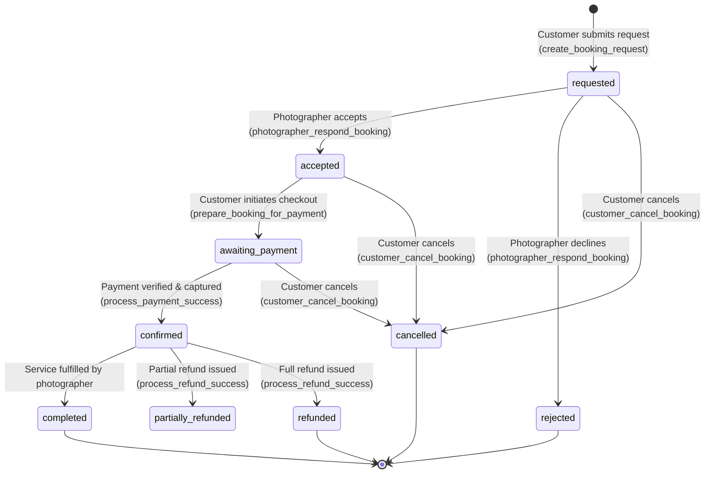

# PYP — Booking Lifecycle & Financial Settlement Workflow

**Project:** PYP (Pick Your Photographer)  
**Scope:** Booking State Machine, Financial Formulas, Checkout, Payment Verification, Chat Unlocking, and Refund Settlement  

---

## 1. Booking State Machine

Every booking request in PYP transitions through an explicit state machine managed by server RPCs and protected by PostgreSQL constraints:



---

## 2. Booking State Transition Matrix

| Current State | Target State | Triggering Actor / RPC | Server Validations & Actions |
| :--- | :--- | :--- | :--- |
| `[None]` | `requested` | Customer via `create_booking_request` | Validates event date is in the future; verifies photographer is published; checks no duplicate active booking exists; calculates 5% fee in integer paise. |
| `requested` | `accepted` | Photographer via `photographer_respond_booking` | Verifies caller is assigned photographer; locks booking row (`FOR UPDATE`); emits customer notification. |
| `requested` | `rejected` | Photographer via `photographer_respond_booking` | Verifies caller is assigned photographer; locks booking row; emits customer notification. |
| `requested` | `cancelled` | Customer via `customer_cancel_booking` | Verifies caller is customer; checks no captured payment exists; updates pending payments to `failed`. |
| `accepted` | `awaiting_payment` | Customer via `prepare_booking_for_payment` | Locks booking row; checks for existing valid pending Razorpay order ID to reuse. |
| `awaiting_payment` | `confirmed` | Service Role via `process_payment_success` | Verifies exact captured amount; records payment; posts platform revenue to `commission_ledger`; creates `pending` photographer payout; unlocks participant chat. |
| `awaiting_payment` | `cancelled` | Customer via `customer_cancel_booking` | Verifies no captured payment exists; marks pending payment orders as `failed`. |
| `confirmed` | `partially_refunded` | Service Role via `process_refund_success` | Validates refund amount > 0 and cumulative total <= captured payment; records `public.refunds` entry; keeps payout `pending`. |
| `confirmed` | `refunded` | Service Role via `process_refund_success` | Validates cumulative refund = captured payment; records `public.refunds` entry; updates payment to `refunded`; reverses `pending` payout. |
| `confirmed` | `completed` | Photographer / Admin | Marks session as completed after event fulfillment. |

---

## 3. Financial Calculation Rules & Formulas

PYP charges customers a transparent **5% platform service fee** on top of the photographer's quoted price. All monetary values are handled strictly in **integer paise** (`1 INR = 100 paise`).

### Formulas:
$$\text{platform\_fee\_paise} = \text{round}\left(\frac{\text{photographer\_quote\_paise} \times 5.0}{100.0}\right)$$
$$\text{customer\_total\_paise} = \text{photographer\_quote\_paise} + \text{platform\_fee\_paise}$$

### Fee Example Table:

| Photographer Quote | Platform Fee (5%) | Total Customer Payable | Photographer Payout | Platform Revenue |
| :---: | :---: | :---: | :---: | :---: |
| **₹1,000** (100,000 paise) | **₹50** (5,000 paise) | **₹1,050** (105,000 paise) | **₹1,000** (100,000 paise) | **₹50** (5,000 paise) |
| **₹2,000** (200,000 paise) | **₹100** (10,000 paise) | **₹2,100** (210,000 paise) | **₹2,000** (200,000 paise) | **₹100** (10,000 paise) |
| **₹5,000** (500,000 paise) | **₹250** (25,000 paise) | **₹5,250** (525,000 paise) | **₹5,000** (500,000 paise) | **₹250** (25,000 paise) |
| **₹12,345** (1,234,500 paise) | **₹617** (61,725 paise) | **₹12,962** (1,296,225 paise) | **₹12,345** (1,234,500 paise) | **₹617** (61,725 paise) |

---

## 4. Participant Chat Unlocking Rule

Realtime chat (`public.chat_messages`) is unlocked **strictly for confirmed or completed bookings**:

```sql
-- RLS Policy: Chat SELECT permission
CREATE POLICY "Chat participants can view messages of confirmed bookings"
  ON public.chat_messages FOR SELECT
  TO authenticated
  USING (
    EXISTS (
      SELECT 1 FROM public.bookings b
      JOIN public.photographer_profiles pp ON pp.id = b.photographer_id
      WHERE b.id = chat_messages.booking_id
        AND (b.customer_id = auth.uid() OR pp.user_id = auth.uid())
        AND b.status IN ('confirmed', 'completed')
    )
  );
```

Attempts by clients or photographers to send or view chat messages for `requested`, `accepted`, `awaiting_payment`, `cancelled`, or `rejected` bookings are rejected by database RLS policies.

---

## 5. Refund & Payout Settlement Accounting

### 5.1 Refund Rules (`private.process_refund_success`)
1. **Input Validation**: Rejects `NULL`, zero, negative, or invalid refund amounts.
2. **Refund Ceiling Enforcement**: Calculates cumulative existing refunds in `public.refunds`. Rejects any refund request if `cumulative_refunds + new_refund > captured_payment_amount`.
3. **Webhook Deduplication**: Rejects duplicate processing if `provider_refund_id` already exists in `public.refunds`.
4. **Partial vs. Full Refund**:
   - If `cumulative_refunds < captured_payment_amount`: Payment status = `partially_refunded`. Photographer payout remains `pending`.
   - If `cumulative_refunds = captured_payment_amount`: Payment status = `refunded`. Pending photographer payout in `public.payouts` is set to `reversed`.

### 5.2 Implementation vs. Planned Payout Behavior
- **Implemented & Tested**:
  - Platform commission posted to `public.commission_ledger`.
  - Photographer payout recorded in `public.payouts` with status `pending`.
  - Payout reversal recorded in `public.payouts` upon full refund.
- **Planned Provider Settlement (Razorpay Route)**:
  - Automatic split transfers to photographer bank accounts require onboarding photographers as Razorpay Linked Accounts (`acc_XXXXX`).
  - Until merchant Route accounts are attached, payouts remain in `pending` status in `public.payouts` without claiming fake money transfers.

---

## 6. Documentation References

- [System Architecture](ARCHITECTURE.md)
- [Security Model & Threat Mitigation](SECURITY_MODEL.md)
- [Database Schema & ER Diagram](DATABASE_SCHEMA.md)
- [Deployment Guide](DEPLOYMENT.md)
