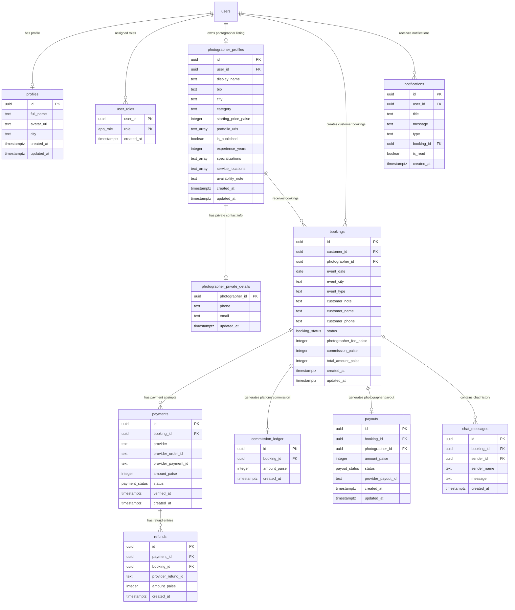

# PYP — Database Schema & Entity Relationship Model

**Engine:** PostgreSQL 17 (Supabase Managed)  
**Schema Architecture:** Forward-Only Migrations (17 Applied SQL Migrations)  

---

## 1. Entity Relationship (ER) Diagram

---

## 2. Custom Enumerated Types (`ENUM`)

- **`public.app_role`**: `'customer'`, `'photographer'`, `'admin'`
- **`public.booking_status`**: `'requested'`, `'pending'`, `'accepted'`, `'declined'`, `'awaiting_payment'`, `'payment_pending'`, `'confirmed'`, `'completed'`, `'cancelled'`, `'rejected'`
- **`public.payment_status`**: `'pending'`, `'captured'`, `'failed'`, `'partially_refunded'`, `'refunded'`
- **`public.payout_status`**: `'pending'`, `'processing'`, `'paid'`, `'failed'`, `'reversed'`

---

## 3. Key Indexes & Performance Constraints

1. **`photographer_city_category_idx`**: Partial index on `photographer_profiles(city, category)` WHERE `is_published = true` for fast discovery queries.
2. **`payments_pending_booking_idx`**: Partial unique index on `payments(booking_id)` WHERE `status = 'pending'`, preventing duplicate pending orders.
3. **`payments_pending_order_unique`**: Partial unique index on `payments(booking_id, status)` WHERE `status = 'pending'`.
4. **`idx_notifications_user_id`**: Index on `notifications(user_id, created_at DESC)`.
5. **`idx_chat_messages_booking`**: Index on `chat_messages(booking_id, created_at ASC)`.
6. **`idx_refunds_payment_id`**: Index on `refunds(payment_id)`.

---

## 4. Chronological Migration Log

| Migration Timestamp | SQL File Name | Major Changes & Purpose |
| :--- | :--- | :--- |
| `20261011134024` | `20261011134024_pyp_initial_schema.sql` | Core schema setup (`profiles`, `user_roles`, `photographer_profiles`, `bookings`, `payments`, `payouts`, `commission_ledger`). |
| `20261011150000` | `20261011150000_pyp_security_and_functions.sql` | Core RLS policies & RPCs (`register_as_photographer`, `create_booking_request`, `photographer_respond_booking`, `prepare_booking_for_payment`, `customer_cancel_booking`). |
| `20261011160000` | `20261011160000_pyp_webhook_events.sql` | `processed_webhook_events` table for webhook idempotency. |
| `20261011170000` | `20261011170000_pyp_concurrency_and_fixes.sql` | `payments_pending_booking_idx`, row locking (`FOR UPDATE`), initial `process_refund_success`. |
| `20261011180000` | `20261011180000_pyp_admin_moderation.sql` | `admin_get_pending_photographers` & `admin_moderate_photographer` RPCs. |
| `20261011190000` | `20261011190000_pyp_portfolio_storage.sql` | `portfolio_images` storage bucket setup with folder-ownership RLS. |
| `20261012000000` | `20261012000000_pyp_rbac_enhancements.sql` | `private.is_admin()`, `private.is_photographer()`, signup trigger, `admin_get_platform_stats` RPC. |
| `20261012120000` | `20261012120000_pyp_rbac_system_complete.sql` | `private.provision_admin()`, admin client & photographer directory RPCs. |
| `20261012130000` | `20261012130000_pyp_storage_security_hardening.sql` | Storage RLS policy hardening. |
| `20261012140000` | `20261012140000_pyp_marketplace_notifications_chat.sql` | `notifications`, `chat_messages`, `send_chat_message` RPC, `mark_notifications_read` RPC, Realtime publication. |
| `20261012150000` | `20261012150000_pyp_photographer_profile_enhancements.sql` | Extended photographer profile fields (`experience_years`, `specializations`, `service_locations`, `availability_note`). |
| `20261012160000` | `20261012160000_pyp_canonical_payment_processor.sql` | Canonical `private.process_payment_success` with default provider `'razorpay'`. |
| `20261013100000` | `20261013100000_pyp_notifications_write_security.sql` | Notification write security hardening (revoked client writes, owner-only SELECT RLS). |
| `20261014000000` | `20261014000000_pyp_invoice_and_settlement_enhancements.sql` | `get_booking_invoice_data` RPC returning authoritative invoice numbers, dates, customer/photographer details, fee breakdown. |
| `20261014120000` | `20261014120000_pyp_payment_conflict_hardening.sql` | `payments_pending_order_unique` partial unique constraint. |
| `20261016110000` | `20261016110000_pyp_payment_rpc_wrappers.sql` | `public.process_payment_success` and `public.process_refund_success` RPC wrappers requiring `service_role`. |
| `20261016120000` | `20261016120000_pyp_refund_ledger_and_hardening.sql` | Auditable `public.refunds` table, incremental vs cumulative refund calculation handling, refund ceiling checks. |

---

## 5. Documentation References

- [System Architecture](ARCHITECTURE.md)
- [Booking Lifecycle](BOOKING_LIFECYCLE.md)
- [Security Model](SECURITY_MODEL.md)
- [Testing Evidence](TESTING.md)
